# Design · CWN สบายจัง รีสอร์ท (CWN Sabai Jang Resort)

ที่มา: `../USER-STORIES-HOTEL.md` (56 story) และ `interview/OWNER-ANSWERS.md` รอบที่ 2 · ทุกแผนภาพเป็น Mermaid และ render เป็นภาพไว้ที่ `design/<ชื่อ>.png`

**วิธีอ่าน**

- อ้างกฎด้วยรหัส story `US-xx` และหัวข้อคำตอบโรงแรม `§x` (เอกสารนี้ข้าม LAB 2 จึงยังไม่มีรหัส FR / BR)
- **⚠️ D-xx** = ทีมตัดสินใจเองระหว่างออกแบบ ดูหัวข้อ 6
- ห้อง R01–R06 · โปร PR-01–PR-13 ตาม `USER-STORIES-HOTEL.md` · ปีทดสอบ 2027 · เวลาทั้งหมดเป็น Asia/Bangkok

| แผนภาพ | จำนวน | ไฟล์ |
|---|---:|---|
| System Architecture | 1 | `architecture.png` |
| Use Case | 1 | `use-case.png` |
| Flowchart | 5 | `flow-search.png` `flow-booking.png` `flow-cancel.png` `flow-price.png` `flow-checkout.png` |
| ERD | 1 | `erd.png` |
| Sequence | 4 | `seq-booking.png` `seq-race.png` `seq-hold-expire.png` `seq-checkout.png` |

---

## 1. System Architecture

<!-- diagram: architecture -->
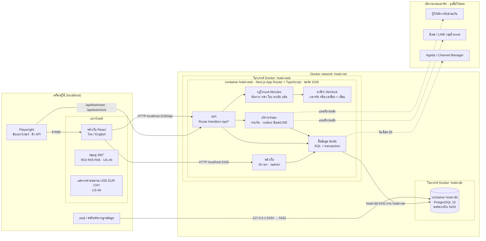

ภาพ: `design/architecture.png`

| ชั้น | อยู่ที่ไหน | หน้าที่ | ทดสอบด้วยอะไร |
|---|---|---|---|
| หน้าเว็บฝั่งเบราว์เซอร์ | เบราว์เซอร์ | แสดงผล 2 ภาษา เก็บค่าที่กรอกระหว่างขั้นจอง แสดงยอดที่ API คิดให้ **ไม่คิดราคาเอง** | Playwright จอ 375×812 และ 1280 · สลับภาษากลางทาง (US-45) |
| 360° และสกุลเงิน | เบราว์เซอร์ | หมุนภาพ `pano-*` · คูณอัตราคงที่ที่ API ส่งมา (ตัดเงินเป็นบาทเสมอ) | Playwright ลากหมุนบนมือถือ · ตรวจข้อความ "เรียกเก็บเป็นเงินบาท" |
| หน้าเว็บฝั่งเซิร์ฟเวอร์ | `hotel-web` | สร้างหน้า `/th` `/en` ห้องพัก โปร ข้อมูลโรงแรม และหลังบ้าน `/admin` ตามบทบาท | Playwright · Lighthouse หน้าแรก ≤ 3 วินาที |
| API | `hotel-web` | ตรวจสิทธิ์ เรียกกฎ เปิด transaction แปลง error เป็นข้อความ 2 ภาษา | Playwright ยิง API ตรง (ไม่ login, ผิดบทบาท, ของคนอื่น) |
| กฎโรงแรม | `hotel-web` `lib/rules` | ฟังก์ชันล้วน: ซีซั่นรายคืน ราคา โปร มัดจำ เวลายกเลิกฟรี แต้ม อายุเด็ก | Vitest ทุกค่าขอบ (ต่ำกว่า / ที่ขอบ / เกินขอบ) |
| นาฬิกา | `hotel-web` `lib/clock` + `app_settings` | ให้ "ตอนนี้" แก่ทุกกฎ · ล็อกและเลื่อนได้เมื่อ `ALLOW_TEST_RESET=1` | `/api/test/clock` แล้วตรวจล็อก 15 นาที Flash Sale เวลายกเลิก |
| บริการจำลอง | `hotel-web` `lib/sim` | จ่ายเงินตามเลขบัตรทดสอบ · เขียนอีเมลและ LINE ลงตาราง `outbox_messages` | อ่าน `/admin/outbox` |
| ฐานข้อมูล | `hotel-db` | เก็บข้อมูลจริง และบังคับกฎสุดท้ายด้วย CHECK, UNIQUE, row lock | psql ผ่าน `127.0.0.1:5434` · Playwright จ่ายพร้อมกัน 2 context |

**อะไรทำที่ไหน**

| ทำในเบราว์เซอร์ | ทำที่เซิร์ฟเวอร์ (`hotel-web`) |
|---|---|
| เลือกวันที่ จำนวนคน อายุเด็ก (ตรวจเบื้องต้นเพื่อ UX เท่านั้น) | ตรวจกฎวันที่ คนสูงสุด ห้องว่างทุกคืน (US-01, US-02, US-03) |
| นับถอยหลัง 15 นาทีจาก `hold_expires_at` ที่ API ส่งมา | ล็อกห้องและปล่อยห้องเมื่อหมดเวลา (US-33) |
| หมุน 360° (US-49) · แปลงสกุลเงินเพื่อแสดง (US-46) | คิดราคา โปร มัดจำ แต้ม (US-11 – US-29, US-34, US-43) |
| แถบสรุปราคาติดล่างจอ (US-08) | จ่ายเงินจำลอง อีเมล LINE (US-34, US-35, US-55) |
| แชตบอต: ส่งข้อความเท่านั้น | แชตบอตตอบด้วยตารางกฎตายตัว (US-50) |

---

## 2. Use Case

<!-- diagram: use-case -->
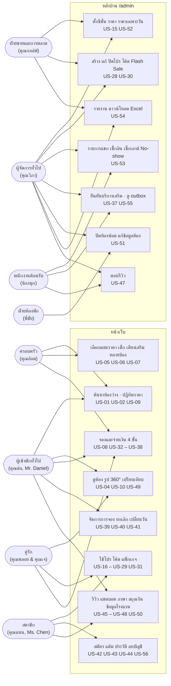

ภาพ: `design/use-case.png` · สิทธิ์หลังบ้านตาม §9: คุณวิภาทุกเมนู · กอล์ฟ A1 A2 A6 · มุก A3 A4 A7 · พี่ชัย A5

### 2.1 บทบาท

| บทบาท | รหัสในระบบ | ใคร | เข้าระบบอย่างไร | ขอบเขต |
|---|---|---|---|---|
| ผู้เข้าพักไม่เป็นสมาชิก | `GUEST` | คุณต่อ, Mr. Daniel, คุณเจ | ไม่ login · เข้าการจองด้วยรหัสการจอง + อีเมล (US-41) | เฉพาะการจองที่รหัสและอีเมลตรงกัน |
| สมาชิกยังไม่ยืนยันอีเมล | `MEMBER_UNVERIFIED` | คุณพลอย | เลือกชื่อจาก dropdown | เหมือน GUEST + บัญชีของตัวเอง · ยังไม่ได้ราคาสมาชิก (§8) |
| สมาชิก | `MEMBER` | คุณแนน, คุณอ้อม, Ms. Chen | เลือกชื่อจาก dropdown | การจอง แต้ม รีวิว บัญชี **ของตัวเองเท่านั้น** |
| ผู้จัดการทั่วไป | `GM` | คุณวิภา | เลือกชื่อจาก dropdown | ทุกเมนูหลังบ้าน |
| ฝ่ายขายและการตลาด | `SALES` | คุณกอล์ฟ | เลือกชื่อจาก dropdown | ซีซั่น ราคา โปร โค้ด Flash Sale รายงาน |
| พนักงานต้อนรับ | `FRONT` | น้องมุก | เลือกชื่อจาก dropdown | รายการแขก เช็กอิน เช็กเอาต์ No-show บริการเสริม outbox รีวิว |
| ฝ่ายห้องพัก | `ROOMS` | พี่ชัย | เลือกชื่อจาก dropdown | ปิดห้องซ่อม ข้อมูลและรูปห้อง |
| ระบบทดสอบ | `TEST` | Playwright | ไม่มีบัญชี · เปิดเมื่อ `ALLOW_TEST_RESET=1` เท่านั้น | `/api/test/reset` `/api/test/clock` |

**เข้าสู่ระบบแบบเว็บสาธิต (demo login)**

- ไม่มีรหัสผ่าน · header ทุกหน้ามี dropdown "ใช้งานในชื่อ" รายชื่อมาจาก `GET /api/demo/users` แสดงเป็น "ชื่อ · บทบาท" และมีตัวเลือกแรก "ไม่เข้าสู่ระบบ (ผู้เข้าพักทั่วไป)"
- เลือกชื่อ → `POST /api/demo/login {userId}` → ตั้ง cookie session (`httpOnly`, `SameSite=Lax`) · เลือก "ไม่เข้าสู่ระบบ" → `POST /api/demo/logout` · เปลี่ยนชื่อแล้วรีโหลดหน้าเดิม ไม่เปลี่ยนหน้า (ใช้ทดสอบ US-22 ข้อ 3)
- สมัครสมาชิก (US-42) ยังมีฟอร์ม: ชื่อ อีเมล วันเกิด ความยินยอมการตลาด · สมัครแล้วชื่อขึ้นใน dropdown ทันทีเป็น `MEMBER_UNVERIFIED` และกดลิงก์ยืนยันอีเมลใน outbox เพื่อเป็น `MEMBER`
- ลบบัญชีแล้วชื่อหายจาก dropdown (US-56)
- **API ยังตรวจสิทธิ์จากบทบาทใน session ทุกเส้นเหมือนเดิม** สิ่งที่เปลี่ยนคือวิธีได้ session มาเท่านั้น
- ทุกหน้ามีป้าย "เว็บสาธิต · เลือกผู้ใช้ได้โดยไม่ต้องใช้รหัสผ่าน" · Google / LINE login (US-42 ข้อ 2) อยู่นอกขอบเขต
- บัญชีทีมงาน (`staff_users`) แยกตารางจากสมาชิก (`users`) แต่อยู่ใน dropdown เดียวกัน · 1 บัญชีมี 1 บทบาท · ทุกการกระทำหลังบ้านบันทึกใน `audit_log`

### 2.2 สิทธิ์ตามบทบาท

✓ = ทำได้ · 👤 = เฉพาะของตัวเอง · – = ทำไม่ได้

| ทำอะไร | GUEST | MEMBER | GM | SALES | FRONT | ROOMS |
|---|:-:|:-:|:-:|:-:|:-:|:-:|
| ค้นหา ดูห้อง โปร ข้อมูลโรงแรม แชตบอต | ✓ | ✓ | ✓ | ✓ | ✓ | ✓ |
| จองและจ่ายเงิน | ✓ | ✓ | – | – | – | – |
| ราคาสมาชิก 5% · แต้ม · ส่วนลดเดือนเกิด | – | 👤 | – | – | – | – |
| ดู ยกเลิก เปลี่ยนวันการจอง | 👤 รหัส+อีเมล | 👤 | ✓ | – | ✓ ดูอย่างเดียว | – |
| ประวัติการพัก · จองอีกครั้ง · ลบบัญชี | – | 👤 | – | – | – | – |
| เขียนรีวิว (เช็กเอาต์แล้ว ≤ 30 วัน) | 👤 | 👤 | – | – | – | – |
| ตอบรีวิว | – | – | ✓ | – | ✓ | – |
| ตั้งซีซั่น ราคา ราคาเฉพาะวัน | – | – | ✓ | ✓ | – | – |
| สร้าง แก้ ปิดโปร โค้ด Flash Sale | – | – | ✓ | ✓ | – | – |
| รายการแขก เช็กอิน เช็กเอาต์ No-show | – | – | ✓ | – | ✓ | – |
| ยืนยัน / ปฏิเสธบริการเสริม | – | – | ✓ | – | ✓ | – |
| ดู outbox อีเมลและ LINE | – | – | ✓ | – | ✓ | – |
| ปิดห้องซ่อม แก้ข้อมูลและรูปห้อง | – | – | ✓ | – | – | ✓ |
| รายงาน + ดาวน์โหลด Excel | – | – | ✓ | ✓ | – | – |
| จัดการบัญชีหลังบ้าน | – | – | ✓ | – | – | – |

### 2.3 การตรวจสิทธิ์ที่ API

| กลุ่ม API | ต้องการ | ไม่ login | login แต่ผิดบทบาท / ของคนอื่น |
|---|---|---|---|
| `GET /api/rooms` `/api/search` `/api/promotions` `/api/chat` | ไม่ต้อง | 200 | - |
| `GET /api/demo/users` `POST /api/demo/login` `/api/demo/logout` | ไม่ต้อง (เว็บสาธิต) | 200 · `userId` ไม่มีหรือถูกลบแล้ว → 404 | - |
| `POST /api/holds` `/api/bookings/{code}/pay` | ผู้ที่สร้างการจองนั้น (session หรือ token ที่ได้ตอนล็อกห้อง) | ไม่มี token → 401 | การจองของคนอื่น → 404 |
| `GET/POST /api/manage/{code}` | รหัส + อีเมลตรงกัน หรือ MEMBER เจ้าของ | อีเมลไม่ตรง → 404 "ไม่พบการจอง" · ผิด 5 ครั้ง → 429 | ของคนอื่น → 404 (ไม่บอกว่ามีอยู่) |
| `/api/me/*` | MEMBER หรือ MEMBER_UNVERIFIED | 401 | - |
| `/api/admin/rates/*` `/api/admin/promotions/*` `/api/admin/reports/*` | GM, SALES | 401 | 403 |
| `/api/admin/arrivals/*` `/api/admin/bookings/*` `/api/admin/addons/*` `/api/admin/outbox` | GM, FRONT | 401 | 403 |
| `/api/admin/reviews/*/reply` | GM, FRONT | 401 | 403 |
| `/api/admin/rooms/*` `/api/admin/closures/*` | GM, ROOMS | 401 | 403 |
| `/api/admin/staff/*` | GM | 401 | 403 |
| `/api/test/reset` `/api/test/clock` | `ALLOW_TEST_RESET=1` | ปิดอยู่ → 404 | - |

- ตรวจสิทธิ์ที่ API ทุกเส้น ไม่พึ่งการซ่อนเมนู (D-08) · ตอบ 404 แทน 403 เมื่อเป็นข้อมูลของคนอื่น เพื่อไม่บอกว่ารหัสการจองนั้นมีอยู่จริง
- หน้า `/admin` ซ่อนเมนูที่บทบาทไม่มีสิทธิ์ แต่ถ้าพิมพ์ URL ตรงจะเห็นหน้า "ไม่มีสิทธิ์เข้าถึง"

---

## 3. Flowchart

### 3.1 ค้นหาห้องว่าง

<!-- diagram: flow-search -->
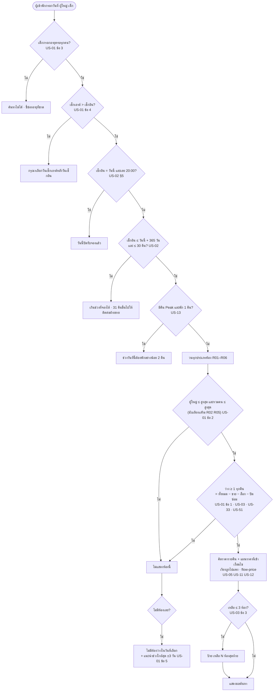

### 3.2 จองและจ่ายเงิน

<!-- diagram: flow-booking -->
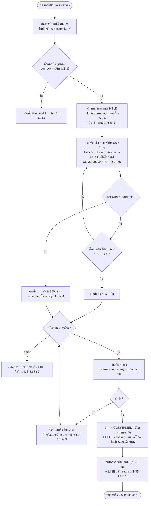

### 3.3 ยกเลิกและเปลี่ยนวัน

<!-- diagram: flow-cancel -->
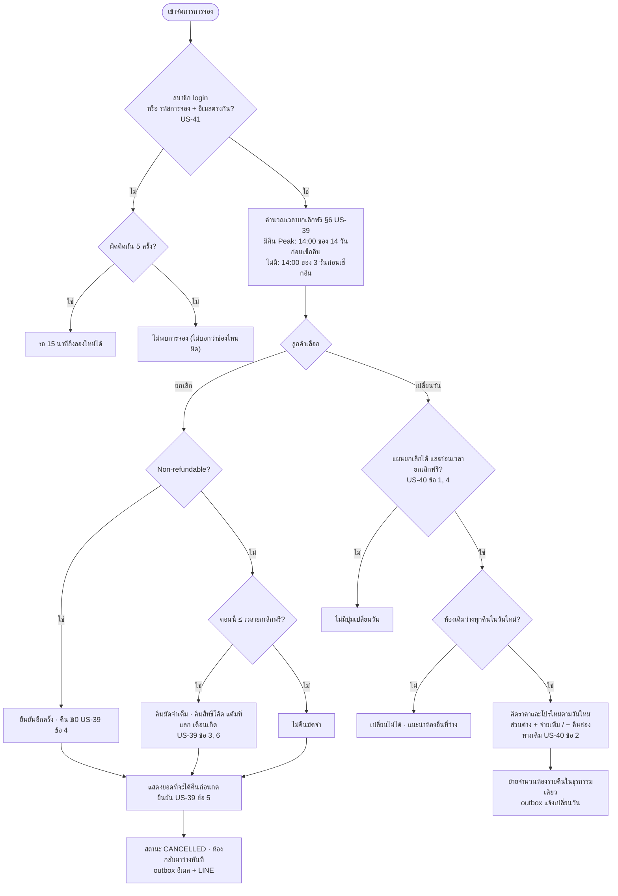

### 3.4 คำนวณราคาสุทธิตามลำดับของโรงแรม (§7)

<!-- diagram: flow-price -->
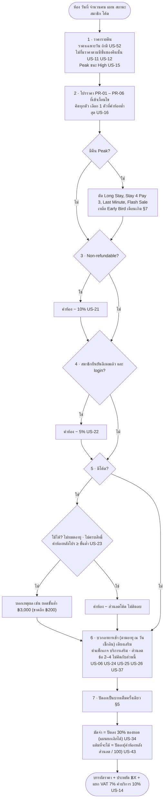

ตัวอย่างตรวจลำดับ: R01 คืน 30 เม.ย. 2027 วันนี้ 1 มี.ค. 2027 · ฿2,400 → Early Bird 15% = ฿2,040 → Non-refundable 10% = ฿1,836 → สมาชิก 5% = ฿1,744.20 → ปัดลง **฿1,744** (US-17, US-21, US-22)

### 3.5 พนักงานกดเช็กเอาต์ และ No-show

<!-- diagram: flow-checkout -->
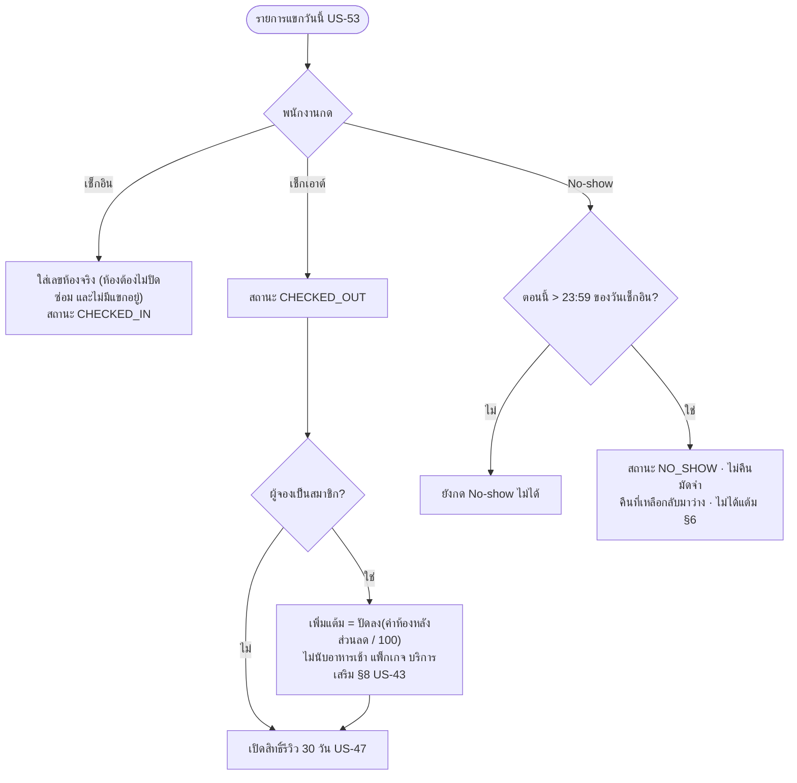

---

## 4. ERD

<!-- diagram: erd -->
```mermaid
erDiagram
  room_types ||--o{ rooms : "มี"
  room_types ||--o{ season_rates : "ราคาตามซีซั่น"
  room_types ||--o{ date_rates : "ราคาเฉพาะวัน"
  room_types ||--o{ inventory_nights : "นับห้องรายคืน"
  room_types ||--o{ room_photos : "รูป"
  rooms ||--o{ room_closures : "ปิดซ่อม"
  seasons ||--o{ season_rates : "ใช้ราคา"
  users ||--o{ bookings : "จอง (สมาชิก)"
  users ||--o{ points_ledger : "แต้ม"
  users ||--o{ birthday_redemptions : "สิทธิ์เดือนเกิด"
  bookings ||--|{ booking_rooms : "ห้องในการจอง 1–5"
  booking_rooms ||--|{ booking_guests : "ผู้เข้าพัก"
  booking_rooms ||--|{ booking_nights : "ราคารายคืนที่ล็อก"
  room_types ||--o{ booking_rooms : "ประเภท"
  rooms |o--o{ booking_rooms : "เลขห้องตอนเช็กอิน"
  bookings ||--|{ booking_price_lines : "บรรทัดราคาที่ล็อก"
  bookings ||--o{ payments : "จ่าย / คืน"
  bookings ||--o{ booking_addons : "บริการเสริม"
  bookings |o--o| tax_invoice_requests : "ใบกำกับภาษี"
  bookings |o--o| reviews : "1 รีวิวต่อการจอง"
  reviews ||--o{ review_replies : "โรงแรมตอบ"
  promotions ||--o{ promo_codes : "โค้ด"
  promotions ||--o{ booking_promotions : "ใช้กับ"
  bookings ||--o{ booking_promotions : "โปรที่ใช้"
  staff_users ||--o{ audit_log : "ทำรายการ"

  room_types {
    text code PK "R01–R06"
    text name_th
    text name_en
    int size_sqm
    int max_adults
    int max_total
    boolean extra_bed_allowed "R02 R05"
    int total_rooms
    text pano_file "R03 R05 R06"
  }
  rooms {
    text room_no PK "101–110, V1"
    text room_type_code FK
  }
  room_closures {
    bigint id PK
    text room_no FK
    date from_date
    date to_date
    text reason
  }
  seasons {
    bigint id PK
    text kind "LOW HIGH PEAK"
    date start_date
    date end_date
  }
  season_rates {
    text room_type_code FK
    text kind
    numeric price "NUMERIC(12,2)"
  }
  date_rates {
    text room_type_code FK
    date night
    numeric price "NUMERIC(12,2)"
  }
  inventory_nights {
    text room_type_code PK
    date night PK
    int total
    int closed
    int sold
    int held
  }
  users {
    bigint id PK
    text email UK
    text display_name "แสดงใน dropdown"
    boolean email_verified
    date birth_date
    text lang "th en"
    boolean marketing_consent "default false"
    timestamptz deleted_at
  }
  bookings {
    text code PK "SJ-2027-000123"
    bigint user_id FK "null = guest"
    text contact_email
    text lang
    text plan "ROOM_ONLY BREAKFAST NONREF PACKAGE"
    text status "HELD CONFIRMED CHECKED_IN CHECKED_OUT CANCELLED NO_SHOW EXPIRED"
    timestamptz hold_expires_at
    date check_in
    date check_out
    numeric total "NUMERIC(12,2)"
    numeric paid "NUMERIC(12,2)"
    numeric due_at_hotel "NUMERIC(12,2)"
    timestamptz free_cancel_until
    int points_to_earn
    int points_redeemed
  }
  booking_rooms {
    bigint id PK
    text booking_code FK
    text room_type_code FK
    text room_no FK "เติมตอนเช็กอิน"
    boolean extra_bed
    text special_request "≤ 500 ตัวอักษร"
  }
  booking_guests {
    bigint id PK
    bigint booking_room_id FK
    text kind "ADULT CHILD"
    int age_at_checkin
  }
  booking_nights {
    bigint booking_room_id FK
    date night
    text season_kind
    numeric base_price "NUMERIC(12,2)"
  }
  booking_price_lines {
    bigint id PK
    text booking_code FK
    text kind "NIGHT PROMO NONREF MEMBER CODE BREAKFAST EXTRABED PACKAGE ADDON ROUNDING"
    text label
    numeric amount "NUMERIC(12,2) ลบ = ส่วนลด"
  }
  payments {
    bigint id PK
    text booking_code FK
    text method "CARD PROMPTPAY"
    text direction "CHARGE REFUND"
    numeric amount "NUMERIC(12,2)"
    text status "SUCCESS FAILED"
    text idempotency_key UK
  }
  promotions {
    text code PK "PR-01…"
    text grp "PRICE STACK PLAN"
    text kind "PERCENT AMOUNT FREE_NIGHT PACKAGE"
    numeric value
    jsonb rules "ล่วงหน้า คืนขั้นต่ำ ซีซั่น ห้อง blackout"
    int quota
    int used
    boolean member_only
    boolean active
  }
  promo_codes {
    text code PK "WELCOME500"
    text promotion_code FK
    numeric discount "NUMERIC(12,2)"
    numeric min_room_total "NUMERIC(12,2)"
    date valid_until
    int max_uses
    int used
  }
  booking_promotions {
    text booking_code FK
    text promotion_code FK
    numeric saved "NUMERIC(12,2)"
  }
  birthday_redemptions {
    bigint user_id FK
    int year
    text booking_code FK
  }
  points_ledger {
    bigint id PK
    bigint user_id FK
    int delta
    text reason "EARN REDEEM REFUND EXPIRE"
    text booking_code FK
  }
  booking_addons {
    bigint id PK
    text booking_code FK
    text kind "TRANSFER EARLY_IN LATE_OUT"
    numeric price "NUMERIC(12,2)"
    text status "PENDING CONFIRMED REJECTED"
    text flight_no
  }
  tax_invoice_requests {
    text booking_code FK
    text company
    text address
    text tax_id "13 หลัก"
    text branch
  }
  reviews {
    bigint id PK
    text booking_code FK
    int room_score
    int service_score
    int clean_score
    int location_score
    text body
  }
  review_replies {
    bigint review_id FK
    bigint staff_id FK
    text body
  }
  staff_users {
    bigint id PK
    text email UK
    text display_name
    text role "GM SALES FRONT ROOMS"
  }
  audit_log {
    bigint id PK
    bigint staff_id FK
    text action
    jsonb detail
  }
  room_photos {
    text room_type_code FK
    int sort
    text file
  }
```

ภาพ: `design/erd.png` · ตารางเสริมที่ไม่วาดเส้นเพื่อให้อ่านง่าย: `outbox_messages` (ช่องทาง ผู้รับ ภาษา หัวเรื่อง เนื้อหา เวลา) · `manage_attempts` (รหัสการจอง + IP นับครั้งผิด) · `fx_rates` (USD EUR CNY อัตราคงที่) · `app_settings` (`frozen_now`, `clock_offset`, `bug_mode`) · `chatbot_rules` · `content_i18n`

**ชนิดข้อมูล**: เงินทุกคอลัมน์ `NUMERIC(12,2)` ไม่ใช้ float · แต้ม `INTEGER` · วันเข้าพักเป็น `DATE` (คืนวันที่ X = คืนที่เริ่มวันที่ X) · เวลาเป็น `TIMESTAMPTZ`

### กลไกห้ามขายห้องเกิน (US-03, US-33, US-51)

1. **นับเป็นแถวรายคืน**: `inventory_nights(room_type_code, night)` มี `total` `closed` `sold` `held` และ `CHECK (sold + held + closed <= total)` เป็นด่านสุดท้ายในฐานข้อมูล
2. **ล็อกแถวตามลำดับเดียวกัน**: จองหรือล็อกห้องทำใน transaction เดียว `SELECT … FOR UPDATE` ทุกคืน **เรียงตามประเภทห้องแล้ววันที่** เพื่อไม่ให้ deadlock จากนั้นเพิ่ม `held` ถ้าคืนไหนเกิน CHECK ทั้ง transaction rollback และตอบ "ห้องนี้เพิ่งถูกจองไป"
3. **การล็อก 15 นาที**: HELD → CONFIRMED ย้ายจำนวนจาก `held` ไป `sold` ในแถวเดิม · หมดเวลาแล้วคืน `held` ด้วยการกวาดแบบ lazy ทุกครั้งที่ค้นหาหรือจอง (`hold_expires_at < clock.now()`) จึงทำงานกับนาฬิกาที่เลื่อนได้โดยไม่ต้องมี cron
4. **จ่ายเงิน**: เรียกจ่ายด้วย `idempotency_key = รหัสการจอง` และ `UNIQUE` ใน `payments` · กดจ่ายซ้ำได้ผลเดิม ไม่ตัดเงินสองครั้ง · ถ้าล็อกหมดอายุระหว่างจ่าย ระบบไม่เรียกจ่าย
5. **ปิดซ่อม**: เพิ่ม `closed` รายคืนได้เมื่อ `sold + held + closed + 1 <= total` เท่านั้น ถ้าเลขห้องนั้นมีการจองอยู่ (มี `room_no` ใน `booking_rooms` หรือห้องที่เหลือไม่พอ) ให้ตอบรหัสการจองที่ติดอยู่ (US-51 ข้อ 2)
6. **ราคาไม่เปลี่ยนย้อนหลัง**: ราคาและโปรทุกบรรทัดถูกคัดลอกลง `booking_nights` และ `booking_price_lines` ตอน CONFIRMED (US-15 ข้อ 4, US-30 ข้อ 2)

---

## 5. Sequence

### 5.1 ผู้เข้าพักจองและจ่ายเงิน

<!-- diagram: seq-booking -->
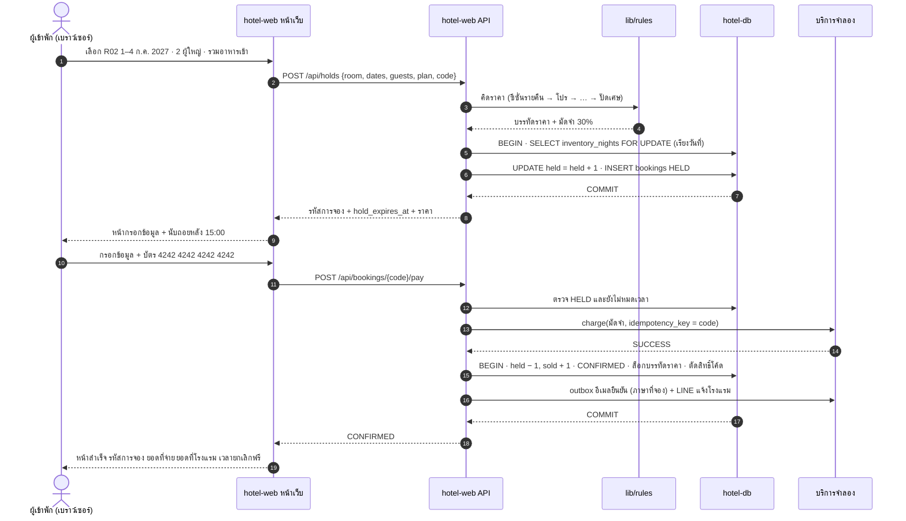

### 5.2 ห้องสุดท้าย 2 คนกดพร้อมกัน

<!-- diagram: seq-race -->
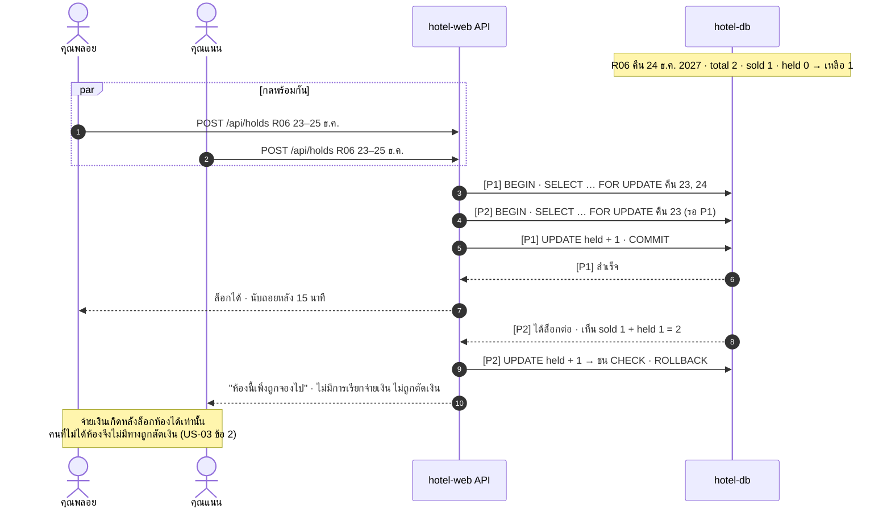

### 5.3 ล็อกครบ 15 นาทีแล้วยังไม่จ่าย

<!-- diagram: seq-hold-expire -->
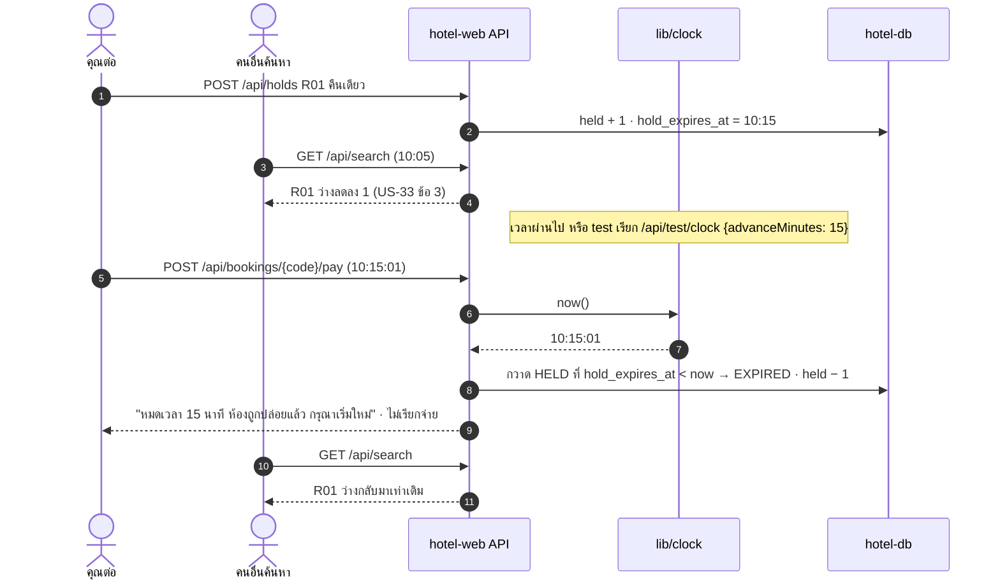

### 5.4 พนักงานกดเช็กเอาต์แล้วแต้มเข้า

<!-- diagram: seq-checkout -->
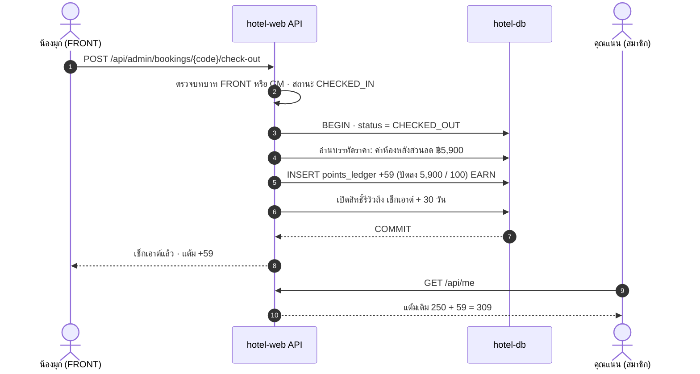

---

## 6. คำถามที่ได้จากการออกแบบ

### ต้องถามโรงแรม

| # | เรื่อง | ทำไมสำคัญ | สมมติฐานที่ใช้ในแบบนี้ |
|---|---|---|---|
| Q-D1 | จองหลายห้องแล้วยกเลิกบางห้องได้ไหม (§11) | กระทบ `booking_rooms` และการคืนมัดจำ | ⚠️ ยกเลิกได้ทั้งการจองเท่านั้น |
| Q-D2 | เปลี่ยนวันได้กี่ครั้ง (§11) | ต้องนับครั้งไหม | ⚠️ ไม่จำกัด ตราบที่ยังก่อนเวลายกเลิกฟรี |
| Q-D3 | Gala Dinner 31 ธ.ค. (Q10, §11) | บรรทัดราคาภาคบังคับ | ⚠️ ยังไม่คิด เตรียม `kind = PACKAGE` ไว้ |
| Q-D4 | แต้มหมดอายุ (§11) | `points_ledger` ต้องมีวันหมดอายุไหม | ⚠️ เก็บ `expires_at` ไว้ แต่ยังไม่ตัด |
| Q-D5 | ใบกำกับภาษีออกเมื่อไร (Q15) | เก็บข้อมูลไว้ แต่การออกเอกสารยังไม่มี | ⚠️ รับข้อมูลตอนจอง ส่งหลังเช็กเอาต์ (นอกระบบ) |
| Q-D6 | เปลี่ยนวันแล้วราคาต่ำลง ต้องคืนมัดจำส่วนเกินหรือหักจากยอดที่โรงแรม | การคืนเงินทางช่องทางเดิม | ⚠️ ลดยอดที่ต้องจ่ายที่โรงแรมก่อน เกินจากนั้นจึงคืน |
| Q-D7 | Flash Sale กับ Non-refundable ซ้อนกันได้ไหม | Flash Sale เป็นโปรราคา | ⚠️ ได้ ตามลำดับ §7 |

### ทีมตัดสินใจเอง

| # | เรื่อง | ตัดสินใจ |
|---|---|---|
| D-01 | ปล่อยห้องที่หมดเวลาล็อก | กวาดแบบ lazy ตอนค้นหาหรือจอง ไม่ใช้ cron เพื่อให้ทำงานกับนาฬิกาที่เลื่อนได้ |
| D-02 | ราคาบนจอ | เบราว์เซอร์แสดงอย่างเดียว เซิร์ฟเวอร์คิดใหม่ทุกครั้งก่อนล็อกและก่อนจ่าย |
| D-03 | รหัสการจอง | `SJ-ปี-เลข 6 หลัก` ไม่เรียงต่อเนื่องจนเดาได้ (ใช้เลขสุ่ม) เพราะใช้เข้าดูการจองคู่กับอีเมล |
| D-04 | อายุเด็ก | เก็บ `age_at_checkin` ตอนจอง ไม่คิดใหม่ภายหลัง (§4) |
| D-05 | ห้องที่ปิดซ่อม | ปิดเป็นเลขห้อง แต่หักออกจากจำนวนรายคืนของประเภทห้อง |
| D-06 | อีเมลและ LINE | เขียนลง `outbox_messages` ใน transaction เดียวกับการเปลี่ยนสถานะ จึงไม่มีอีเมลยืนยันสำหรับการจองที่ไม่สำเร็จ |
| D-07 | ลบบัญชี (US-56) | ลบข้อมูลส่วนตัวใน `users` แต่เก็บ `bookings` และ `tax_invoice_requests` ไว้ตามกฎหมาย โดยตัดการเชื่อมกับตัวบุคคล |
| D-08 | สิทธิ์หลังบ้าน | ตรวจบทบาทที่ API ทุกเส้น ไม่พึ่งการซ่อนเมนู |
